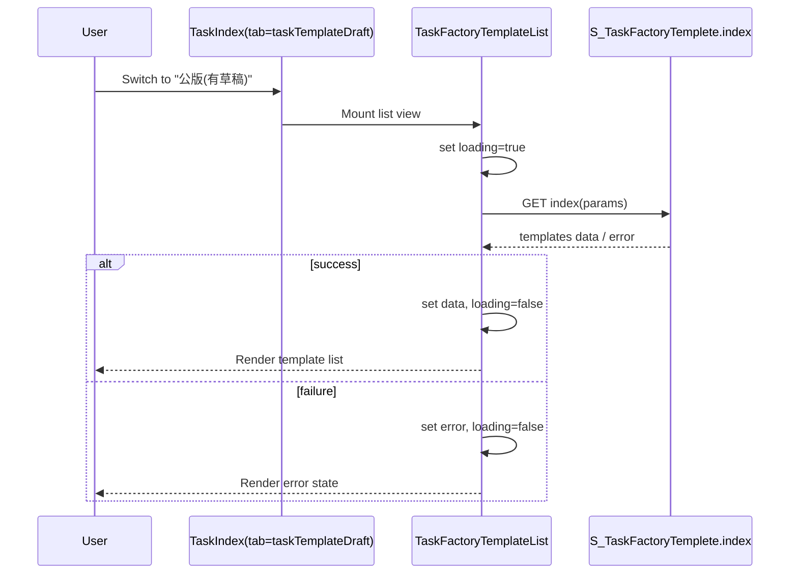

## Context

目前 `Task` 首層 tab 的 `taskTemplateDraft` 僅顯示占位內容，未串接資料來源。既有頁面已具備 tab/header 動態切換邏輯，因此本次設計目標是在不影響 `taskList` 現有流程下，新增一個可載入任務公版草稿清單的顯示層，並以 `S_TaskFactoryTemplete.index` 作為單一資料來源。

限制與條件：
- React Native 現有元件規範以 `Ws*` 元件優先。
- 需維持 Task 主流程（建立任務、任務列表、TaskShow 返回）的 header 行為穩定。
- 目前 API contract 不變，僅消費現有 `index`。

利害關係人：
- 前端 App（Task 模組）
- 後端 API（Task Factory Template index 回傳）
- QA（任務頁 tab 與 header 行為驗證）

## Goals / Non-Goals

**Goals:**
- 在 `taskTemplateDraft` tab 顯示任務公版清單。
- 使用 `S_TaskFactoryTemplete.index` 取得列表資料，並處理 loading/empty/error 狀態。
- 讓 `headerRight` 在 `taskTemplateDraft` 保持可擴充（可開 modal），且不干擾 `taskList` 的建立任務行為。

**Non-Goals:**
- 不修改後端 API schema 或新增 API endpoint。
- 不在本次納入任務公版新增/編輯/刪除完整流程。
- 不調整 `taskCommonTemplate` 的資料流與商業規則。

## Decisions

### 1) 在 Task 模組新增獨立清單 section，而非把邏輯塞回 `Task/Index.tsx`
- Decision: 新增或調整 `Task` 底下的 template list section（例如 `src/sections/Task/TaskFactoryTemplateList.tsx`）負責資料抓取與列表渲染。
- Rationale: 降低 `Task/Index.tsx` 責任，避免首層 tab + header 邏輯與資料流程耦合。
- Alternative considered:
  - 直接在 `Task/Index.tsx` 內抓 API：實作快，但 state 膨脹、後續維護差。

### 2) 以單一請求入口 `S_TaskFactoryTemplete.index` + 本地狀態管理
- Decision: `useEffect` 進頁觸發請求，使用 `loading/data/error` 三態。
- Rationale: 功能範圍單純，無需引入額外狀態庫；可快速穩定落地。
- Alternative considered:
  - 共用 `WsPageIndex/WsInfiniteScroll`：若欄位/篩選需求尚未固定，先用最小設計可降低導入風險。

### 3) Header 互動採「tab 驅動」策略，維持既有任務分支不變
- Decision: 延用 `Task/Index.tsx` 依 `tabIndex` 設定 `navigation.setOptions({ headerRight })`。
- Rationale: 已有行為可工作；只擴增 `taskTemplateDraft` 分支，不修改 `taskList` 路徑。
- Alternative considered:
  - 移至 route options 全部統一：改動面較大，容易影響既有 header 稳定性。

### 4) 錯誤處理採 UI 內顯示 + 不阻塞切 tab
- Decision: API 失敗時顯示錯誤狀態元件（或文字），tab 仍可切換。
- Rationale: 降低整頁阻塞風險；符合行動端容錯體驗。
- Alternative considered:
  - 失敗直接 Alert + 返回：會中斷使用者流程，體驗較差。

### Sequence Diagram

## Risks / Trade-offs

- [Risk] API 回傳欄位與 UI 預期不一致（例如缺少名稱/更新時間）  
  → Mitigation: 先在列表層做欄位 fallback（`--`），並記錄必要欄位檢查點給後端。

- [Risk] Tab 切換導致重複請求與等待時間變長  
  → Mitigation: 進頁請求加上最小快取策略（本次 session 內有資料則不重抓，或 focus 時不強制刷新）。

- [Risk] headerRight 動態切換造成既有按鈕行為回歸  
  → Mitigation: 加入 QA 驗證矩陣（taskList / taskTemplateDraft / taskCommonTemplate 三個 tab）。

- [Trade-off] 不使用通用 infinite scroll 能較快落地，但可重用性較低  
  → Mitigation: 後續若需求擴大，再重構到通用列表容器。

## Migration Plan

1. 新增 task template draft 列表 view/section，完成 `S_TaskFactoryTemplete.index` 串接。
2. 將 `taskTemplateDraft` tab 的占位畫面替換為新列表元件。
3. 驗證 headerRight 在三個 tab 的對應行為（建立任務 / 開啟 modal / 無按鈕）。
4. QA 回歸 Task 建立/編輯/回上一頁流程，確認不受影響。
5. 上線後若發生異常，回退到占位 UI 版本（保留現有 tab 結構與 header 邏輯）。

## Open Questions

- `S_TaskFactoryTemplete.index` 的必要欄位最終契約（顯示名稱、草稿狀態、更新時間）是否已穩定？
- 清單是否需要分頁/搜尋/篩選（本次先不做）？
- `taskCommonTemplate` 是否後續共用同一資料模型或 API？
